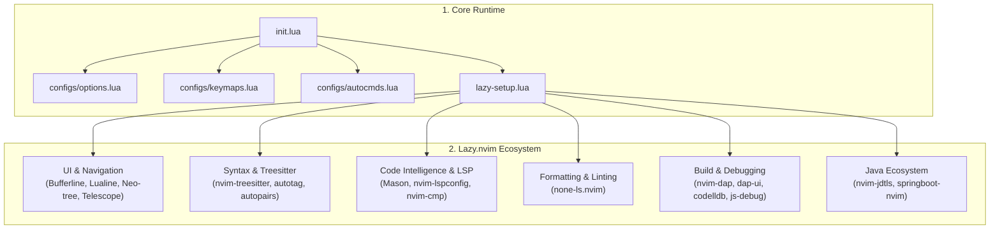

# ⚡ Engineering Neovim IDE Documentation

> **Hệ thống cấu hình Neovim hiệu năng cao dành cho kỹ sư phần mềm, tối ưu hóa cho C/C++, TypeScript/JavaScript, Java/Spring Boot, Go, Ruby và Lua.**

---

## 🧭 Cổng Tài liệu Kỹ thuật (Documentation Portal)

Tài liệu được phân tách theo từng trang chuyên sâu chuẩn Wiki / Notion nội bộ doanh nghiệp. Nhấp vào các liên kết bên dưới để xem chi tiết:

| Module | Chủ đề | Tóm tắt nội dung |
| :--- | :--- | :--- |
| 🏛️ **[01. Kiến trúc & Hệ thống](file:///c:/Users/duong/Documents/nvim/docs/01-architecture.md)** | `docs/01-architecture.md` | Luồng khởi động từ `init.lua`, nguyên tắc module hóa, sơ đồ thư mục |
| 📦 **[02. Quản lý Plugin](file:///c:/Users/duong/Documents/nvim/docs/02-plugin-management.md)** | `docs/02-plugin-management.md` | Cơ chế Lazy.nvim, quy trình thêm/xóa plugin, bảo trì `lazy-lock.json` |
| 🧠 **[03. LSP, Linter & Formatter](file:///c:/Users/duong/Documents/nvim/docs/03-lsp-formatting-linting.md)** | `docs/03-lsp-formatting-linting.md` | Cấu hình Mason, nvim-lspconfig, None-ls (Prettier, Clang-format, Stylua) |
| 🚀 **[04. Biên dịch, Chạy & Gỡ lỗi](file:///c:/Users/duong/Documents/nvim/docs/04-build-run-debug.md)** | `docs/04-build-run-debug.md` | Chạy nhanh file `<leader>rc`, Debugger DAP (CodeLLDB, JS-Debug, Spring Boot) |
| ⌨️ **[05. Bảng tra cứu Phím tắt](file:///c:/Users/duong/Documents/nvim/docs/05-keybindings-cheatsheet.md)** | `docs/05-keybindings-cheatsheet.md` | Cheat sheet toàn diện: Window, Buffer, Telescope, Git, Debug, Spring Boot |
| 🛠️ **[06. Cài đặt & Xử lý sự cố](file:///c:/Users/duong/Documents/nvim/docs/06-setup-and-troubleshooting.md)** | `docs/06-setup-and-troubleshooting.md` | Yêu cầu môi trường (Windows/Linux), cài đặt máy mới, FAQ sửa lỗi |

---

## 🗺️ Sơ đồ Kiến trúc Hệ thống (System Architecture)



---

## ⚡ Bảng tóm tắt tính năng & Phím tắt cốt lõi

### 🎯 Tác vụ Code, Linter & Format
* **Format code:** `<leader>cf` — Tự động định dạng tài liệu theo Prettier (Web), Clang-format (C++), Stylua (Lua), Gofumpt (Go).
* **Xem chi tiết lỗi:** `<leader>e` — Mở popup xem thông tin lỗi / warning tại con trỏ.
* **Gập / Mở code:** `<Tab>` — Đóng mở khối code bằng Treesitter folding.

### 🏃 Chạy nhanh & Biên dịch (Build & Run)
* **Chạy file hiện tại:** `<leader>rc` — Tự động lưu và thực thi trong terminal split:
  * `.cpp` / `.c`: Tự động biên dịch qua `g++` và chạy file `.exe`.
  * `.ts` / `.tsx`: Chạy trực tiếp qua `npx tsx`.
  * `.js` / `.jsx`: Chạy qua `node`.

### 🐞 Gỡ lỗi (DAP Debugger)
* **Đặt / Hủy điểm dừng:** `<leader>dp`
* **Bắt đầu / Tiếp tục:** `<leader>dc` (Tự động mở giao diện trực quan `dap-ui`)
* **Dừng debug:** `<leader>dx` (Tự động đóng `dap-ui`)
* **Nhảy vào hàm:** `<C-n>`

### 🔍 Tìm kiếm & Quản lý File
* **Mở / Đóng cây thư mục:** `<leader>op` / `<leader>xp` (Neo-tree)
* **Tìm file theo tên:** `<leader>ff` (Telescope)
* **Tìm kiếm nội dung:** `<leader>fg` (Live Grep)
* **Đổi tab / buffer:** `<leader>bn` (Kế tiếp), `<leader>bx` (Đóng buffer)

---

## 💻 Cài đặt nhanh (Quick Start)

```bash
# 1. Clone cấu hình về thư mục Neovim trên Windows PowerShell
git clone https://github.com/Khoi1308/nvim.git $env:LOCALAPPDATA\nvim

# 2. Khởi động Neovim (Plugin và LSP sẽ tự động được tải và cấu hình)
nvim
```
> Xem thêm tài liệu chi tiết tại **[`docs/06-setup-and-troubleshooting.md`](file:///c:/Users/duong/Documents/nvim/docs/06-setup-and-troubleshooting.md)** nếu bạn gặp sự cố về compiler hoặc môi trường runtime.
