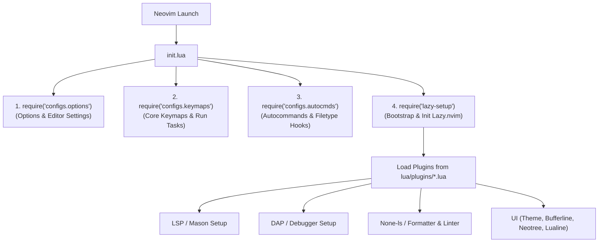

# 🏛️ Architecture & System Structure

Tài liệu này mô tả chi tiết kiến trúc tổng thể, luồng khởi động và cấu trúc thư mục của hệ thống Neovim.

---

## 1. 🔄 Luồng khởi động (Bootstrapping Flow)

Khi Neovim khởi động, file [`init.lua`](file:///c:/Users/duong/Documents/nvim/init.lua) tại thư mục gốc là điểm vào (entry point) duy nhất. Quá trình nạp được thực hiện tuần tự theo 4 giai đoạn:



### Nguyên tắc thiết kế:
* **Tách biệt Core và Plugins:** Các cấu hình thuần Neovim (Settings, Keymaps cơ bản, Autocmds) được nạp trước mà không phụ thuộc vào bất kỳ plugin bên ngoài nào.
* **Module hóa Plugin:** Toàn bộ plugin được định nghĩa theo cấu trúc Lazy.nvim specs trong thư mục `lua/plugins/`. Khi thêm một tính năng mới, chỉ cần tạo thêm file `.lua` trong thư mục này mà không cần sửa file `init.lua`.

---

## 2. 📂 Cấu trúc thư mục chi tiết

```text
nvim/
├── init.lua                           # Điểm nhập cuộc (Entry point)
├── README.md                          # Documentation Hub chính
├── docs/                              # Tài liệu kỹ thuật chi tiết (Notion / Wiki style)
│   ├── 01-architecture.md             # Kiến trúc & luồng khởi động
│   ├── 02-plugin-management.md        # Quản lý plugin (lazy.nvim)
│   ├── 03-lsp-formatting-linting.md   # LSP, Formatter & Linter
│   ├── 04-build-run-debug.md          # Biên dịch, chạy file & Debugger (DAP)
│   ├── 05-keybindings-cheatsheet.md   # Bảng tra cứu phím tắt
│   └── 06-setup-and-troubleshooting.md# Cài đặt môi trường & xử lý lỗi
├── ftplugins/                         # Cấu hình chuyên biệt theo loại file
│   └── java.lua                       # Cấu hình nvim-jdtls khi mở file Java
├── js-debug-dap-v1.100.0/             # VS Code Debug Server phục vụ debug JS/TS
├── lazy-lock.json                     # Snapshot phiên bản chính xác của các plugin
└── lua/
    ├── lazy-setup.lua                 # Bootstrap và cấu hình Lazy.nvim
    ├── configs/                       # Cấu hình Core (Không phụ thuộc plugin)
    │   ├── options.lua                # Các thiết lập Neovim (tab, số dòng, clipboard...)
    │   ├── keymaps.lua                # Phím tắt chung, quản lý window, run code
    │   ├── autocmds.lua               # Tự động hóa sự kiện hệ thống
    │   └── jdtls.lua                  # Script hỗ trợ cấu hình Eclipse JDTLS cho Java
    └── plugins/                       # Khai báo plugin (Lazy plugin specifications)
        ├── autopairs.lua              # Tự động đóng ngoặc
        ├── bufferline.lua             # Thanh tab quản lý buffers trên đỉnh màn hình
        ├── colorscheme.lua            # Giao diện màu (Cyberdream / Tokyonight / Catppuccin)
        ├── completions.lua            # Hệ thống gợi ý code (nvim-cmp + Luasnip)
        ├── debugging.lua              # Debugger Protocol (nvim-dap, codelldb, pwa-node)
        ├── gitsigns.lua               # Tích hợp Git (thay đổi dòng, blame, hunk preview)
        ├── lsp-configs.lua            # Language Server Protocol (Mason + nvim-lspconfig)
        ├── lualine.lua                # Thanh trạng thái (Statusline)
        ├── luarocks.lua               # Trình quản lý package luarocks
        ├── neo-tree.lua               # Cây quản lý file & thư mục
        ├── none-ls.lua                # Linter & Formatter đa ngôn ngữ (null-ls)
        ├── springboot-nvim.lua        # Công cụ chuyên biệt cho Java Spring Boot
        ├── telescope.lua              # Fuzzy finder tìm file, text, symbols
        ├── treesitter.lua             # Cú pháp cây nâng cao (Syntax highlighting, indent)
        └── which-key.lua              # Menu gợi ý phím tắt khi nhấn phím chờ
```

---

## 3. 🎯 Trách nhiệm của các Module cốt lõi

| File / Thư mục | Trách nhiệm chính |
| :--- | :--- |
| [`lua/configs/options.lua`](file:///c:/Users/duong/Documents/nvim/lua/configs/options.lua) | Quản lý setting biên soạn: `expandtab`, `shiftwidth = 2`, `clipboard = unnamedplus`, `foldmethod = expr` bằng treesitter, hiển thị dấu `signcolumn`. |
| [`lua/configs/keymaps.lua`](file:///c:/Users/duong/Documents/nvim/lua/configs/keymaps.lua) | Thiết lập `mapleader = " "`, điều hướng cửa sổ (`<leader>w*`), thụt lề Visual mode (`<`/`>`), và tác vụ chạy code nhanh `<leader>rc`. |
| [`lua/configs/autocmds.lua`](file:///c:/Users/duong/Documents/nvim/lua/configs/autocmds.lua) | Hook kích hoạt Java LSP tự động khi phát hiện filetype `java`. |
| [`lua/plugins/`](file:///c:/Users/duong/Documents/nvim/lua/plugins) | Tách từng plugin thành một file độc lập, dễ dàng bật/tắt hoặc thử nghiệm mà không ảnh hưởng toàn hệ thống. |
