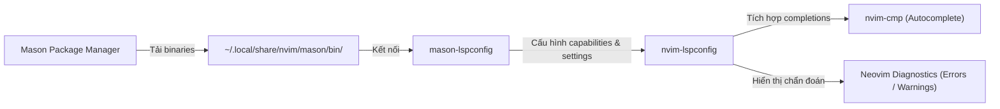

# 🧠 LSP, Linter & Code Formatting Guide

Tài liệu này chi tiết hóa cách hệ thống Neovim xử lý **Language Server Protocol (LSP)**, **Kiểm tra cú pháp (Linter)**, và **Định dạng mã nguồn (Formatter)** cho môi trường phát triển đa ngôn ngữ.

---

## 1. 🏗️ Kiến trúc bộ ba công cụ LSP

Hệ thống phối hợp 3 thành phần chính:
1. **[Mason.nvim](file:///c:/Users/duong/Documents/nvim/lua/plugins/lsp-configs.lua#L3)**: Trình quản lý package độc lập, tự động cài đặt LSP binary, Linter, Formatter và Debug Adapter vào máy cục bộ.
2. **[Mason-lspconfig.nvim](file:///c:/Users/duong/Documents/nvim/lua/plugins/lsp-configs.lua#L13)**: Cầu nối đồng bộ danh sách LSP giữa Mason và cấu hình Neovim.
3. **[nvim-lspconfig](file:///c:/Users/duong/Documents/nvim/lua/plugins/lsp-configs.lua#L37)**: Cung cấp cấu hình chuẩn để kết nối Neovim với các server chạy nền.

---

## 2. 🌐 Ma trận hỗ trợ ngôn ngữ (Language Matrix)

| Ngôn ngữ | Language Server (LSP) | Formatter (Format code) | Linter (Bắt lỗi) |
| :--- | :--- | :--- | :--- |
| **C / C++** | `clangd` | `clang-format` | `clangd` diagnostics |
| **TypeScript / JS** | `ts_ls`, `eslint` | `prettier` | `eslint` |
| **Java** | `jdtls` (`nvim-jdtls`) | Eclipse Formatter (`jdtls`) | `jdtls` compiler |
| **Go** | `gopls` | `gofumpt`, `goimports_reviser`, `golines` | `gopls` staticcheck |
| **Lua** | `lua_ls` | `stylua` | `lua_ls` diagnostics |
| **Ruby / ERB** | — | `rubocop` | `rubocop`, `erb_lint` |
| **Web (HTML/CSS)** | `html`, `cssls` (tuỳ chọn) | `prettier` | LSP built-in |

---

## 3. 🧹 Formatter & Linter qua `none-ls.nvim`

Toàn bộ quá trình chuẩn hóa code được xử lý tập trung tại [`lua/plugins/none-ls.lua`](file:///c:/Users/duong/Documents/nvim/lua/plugins/none-ls.lua).

### Danh sách các Source đang kích hoạt:
* **Lua:** `stylua` — Định dạng chuẩn theo phong cách Lua chính thống.
* **Prettier:** Định dạng file JavaScript, TypeScript, JSX, TSX, JSON, YAML, HTML, CSS, Markdown.
* **C / C++:** `clang-format` — Căn lề và phong cách theo chuẩn Clang/LLVM.
* **Golang:**
  * `gofumpt`: Định dạng code nghiêm ngặt hơn `gofmt`.
  * `goimports_reviser`: Sắp xếp và nhóm các package import chuẩn xác.
  * `golines`: Tự động ngắt dòng khi câu lệnh vượt quá độ dài quy định.
* **Ruby:** `rubocop` (Formatting & Linting), `erb_lint` (Kiểm tra template ERB).

### ⌨️ Phím tắt Định dạng & Chẩn đoán lỗi
* `<leader>cf` : Chạy format code theo tài liệu đang mở ([`vim.lsp.buf.format`](file:///c:/Users/duong/Documents/nvim/lua/plugins/none-ls.lua#L29)).
* `<leader>e` : Mở popup hiển thị chi tiết lỗi/cảnh báo tại con trỏ ([`vim.diagnostic.open_float`](file:///c:/Users/duong/Documents/nvim/lua/configs/keymaps.lua#L20)).
* `[d` / `]d` : Nhảy tới lỗi phía trước / phía sau.

---

## 4. 💡 Tính năng Inlay Hints & Folding

Được cấu hình trong [`lua/plugins/lsp-configs.lua`](file:///c:/Users/duong/Documents/nvim/lua/plugins/lsp-configs.lua#L56-L68) cho TypeScript:
* Tự động hiển thị gợi ý kiểu dữ liệu tham số hàm (`includeInlayParameterNameHints`).
* Hiển thị kiểu trả về của function (`includeInlayFunctionParameterTypeHints`).
* Gợi ý kiểu của biến khi khai báo (`includeInlayVariableTypeHints`).
* Tích hợp gập mã nguồn (Code Folding) với Treesitter và LSP folding range qua phím `<Tab>`.
