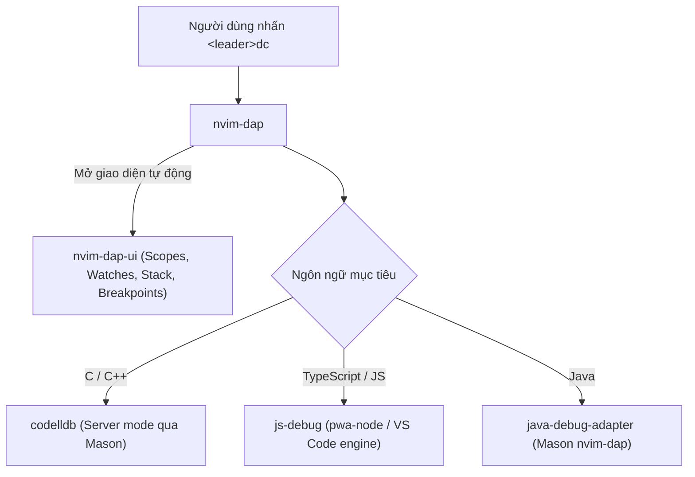

# 🚀 Build, Run & Debugging Guide

Tài liệu này hướng dẫn cách thực thi mã nguồn nhanh (Quick Run), biên dịch các ngôn ngữ compiled (C/C++), và sử dụng hệ thống gỡ lỗi chuyên sâu chuẩn DAP (Debug Adapter Protocol).

---

## 1. ⚡ Tác vụ Chạy nhanh & Biên dịch (Quick Run - `<leader>rc`)

Hệ thống được tích hợp sẵn một task runner thông minh tại [`lua/configs/keymaps.lua`](file:///c:/Users/duong/Documents/nvim/lua/configs/keymaps.lua#L27-L44) gán vào phím tắt:

> **`<leader>rc`** (Run Code)

### Cơ chế hoạt động:
1. Tự động lưu (`:write`) file hiện tại trước khi thực thi.
2. Mở một cửa sổ Terminal chuyên dụng ở đáy màn hình (`botright split | resize 12`).
3. Tùy thuộc vào đuôi file, hệ thống sẽ thực thi lệnh tương ứng:

| Đuôi file | Cơ chế biên dịch & chạy | Lệnh thực thi ngầm |
| :--- | :--- | :--- |
| **`.cpp` / `.c`** | Biên dịch qua GCC/G++ rồi tự động chạy file binary | **Windows:** `g++ <file> -o <name>.exe && .\<name>.exe` **Linux/macOS:** `g++ <file> -o <name> && ./<name>` |
| **`.ts` / `.tsx`** | Chạy trực tiếp TypeScript không cần build qua `tsx` | `npx tsx <file>` |
| **`.js` / `.jsx`** | Chạy trực tiếp bằng Node.js | `node <file>` |
| **Khác** | Báo thông báo cảnh báo | `vim.notify(...)` |

---

## 2. 🐞 Hệ thống Debugger chuyên sâu (nvim-dap + dap-ui)

Khi cần đặt điểm dừng (breakpoint), duyệt biến và xem call stack từng bước, cấu hình tại [`lua/plugins/debugging.lua`](file:///c:/Users/duong/Documents/nvim/lua/plugins/debugging.lua) sẽ chịu trách nhiệm.

### A. Debugging C / C++ (CodeLLDB)
* Sử dụng server **CodeLLDB** được Mason cài đặt trong `stdpath("data")/mason/bin/`.
* Tự động nhận diện môi trường Windows (`codelldb.cmd`) hoặc Unix (`codelldb`).
* **Cách sử dụng:**
  1. Biên dịch code C++ với cờ debug: `g++ -g main.cpp -o main.exe`
  2. Mở file `main.cpp`, nhấn `<leader>dp` tại dòng muốn dừng.
  3. Nhấn `<leader>dc`. Neovim sẽ hỏi đường dẫn file thực thi: nhập `main.exe` rồi Enter.
  4. Giao diện DAP UI sẽ tự động mở lên.

### B. Debugging JavaScript / TypeScript (`js-debug` / `pwa-node`)
* Tích hợp máy chủ chính thức của Microsoft VS Code [js-debug-dap-v1.100.0](file:///c:/Users/duong/Documents/nvim/js-debug-dap-v1.100.0/js-debug/src/dapDebugServer.js).
* **3 kịch bản Debug linh hoạt:**
  1. **Launch TS with tsx (Direct .ts debug):** Debug trực tiếp file TypeScript hiện tại mà không cần `tsc` biên dịch trung gian.
  2. **Launch Current File:** Debug file JavaScript hoặc file build bằng Node.js tiêu chuẩn.
  3. **Attach to Process:** Debug một server đang chạy (như NestJS, Express backend). Neovim sẽ mở danh sách các PID tiến trình Node đang chạy để bạn chọn gắn debugger vào.

---

## 3. ☕ Tác vụ Chuyên biệt cho Java & Spring Boot

Được cấu hình thông qua [`lua/plugins/springboot-nvim.lua`](file:///c:/Users/duong/Documents/nvim/lua/plugins/springboot-nvim.lua) và [`lua/configs/jdtls.lua`](file:///c:/Users/duong/Documents/nvim/lua/configs/jdtls.lua):

| Phím tắt | Tác vụ | Mô tả |
| :--- | :--- | :--- |
| `<leader>Jr` | **Spring Boot Run** | Chạy project Spring Boot hiện tại ngay trong terminal tích hợp |
| `<leader>Jc` | **Create Class** | Mở bảng tạo Class Java chuẩn kèm package declaration |
| `<leader>Ji` | **Create Interface** | Tạo nhanh interface theo chuẩn dự án |
| `<leader>Je` | **Create Enum** | Tạo nhanh Enum |

---

## 4. 🎛️ Bảng phím tắt điều khiển Debug (DAP Controls)

| Phím tắt | Tên hành động | Chức năng |
| :--- | :--- | :--- |
| `<leader>dp` | **Toggle Breakpoint** | Đặt hoặc xóa điểm dừng tại dòng con trỏ |
| `<leader>dc` | **Continue / Start** | Bắt đầu phiên debug hoặc tiếp tục chạy tới breakpoint tiếp theo |
| `<leader>dx` | **Disconnect** | Ngắt kết nối debugger và tự động đóng cửa sổ DAP UI |
| `<C-n>` | **Step Into** | Nhảy vào bên trong hàm (Function step in) |
